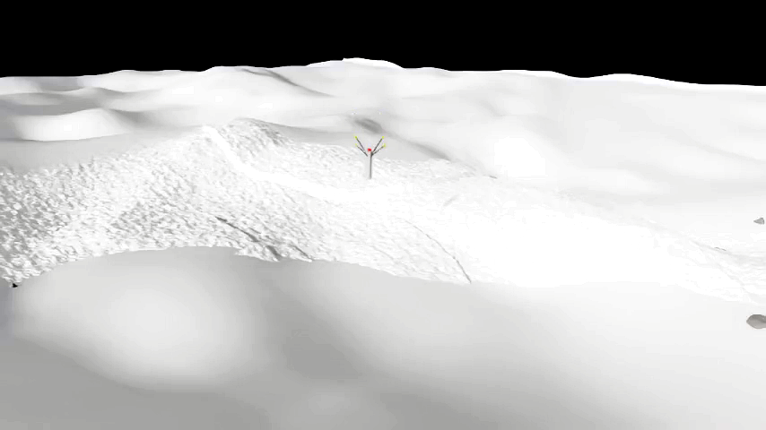
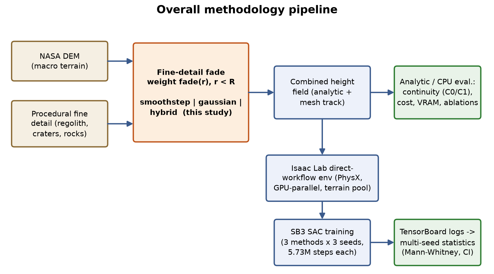
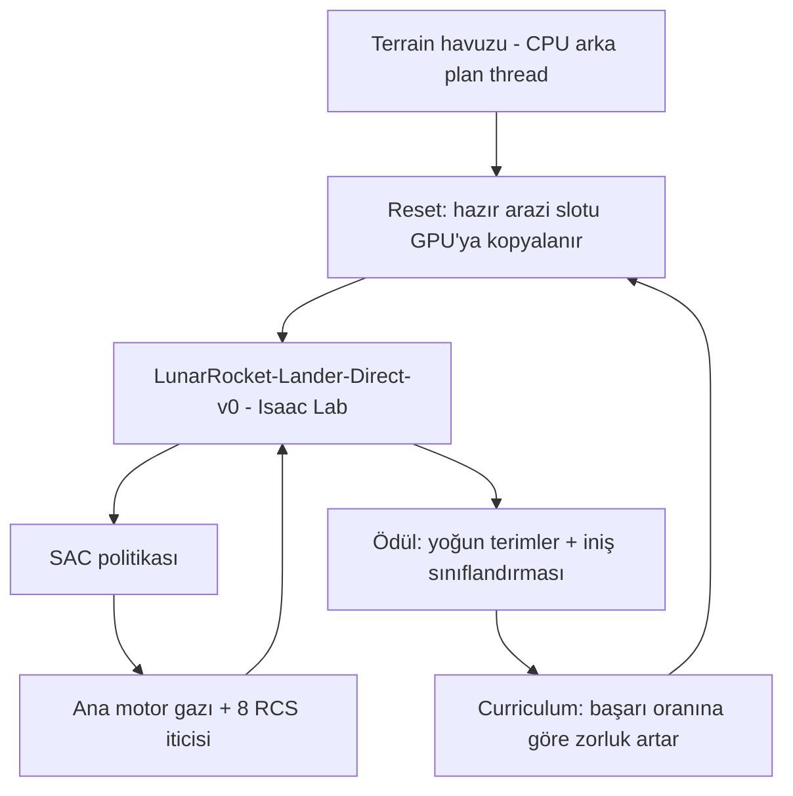
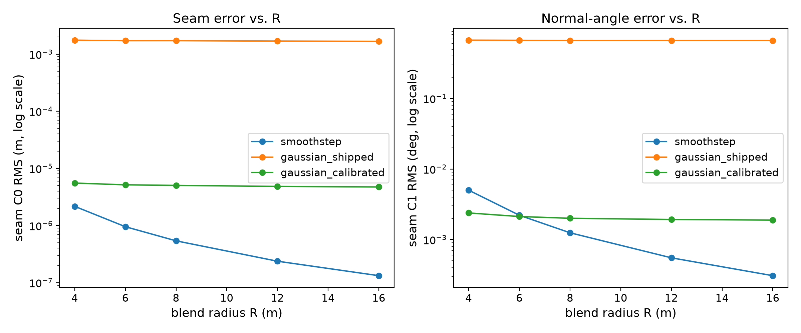
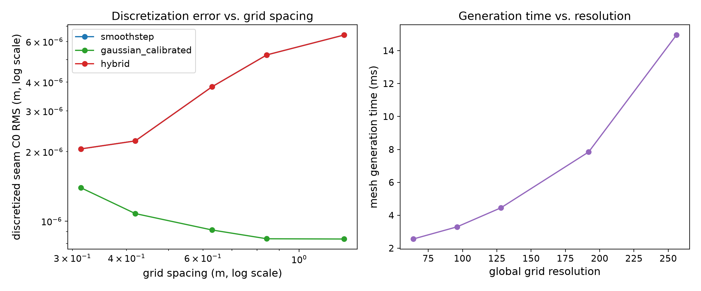
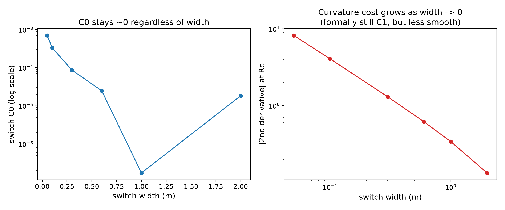
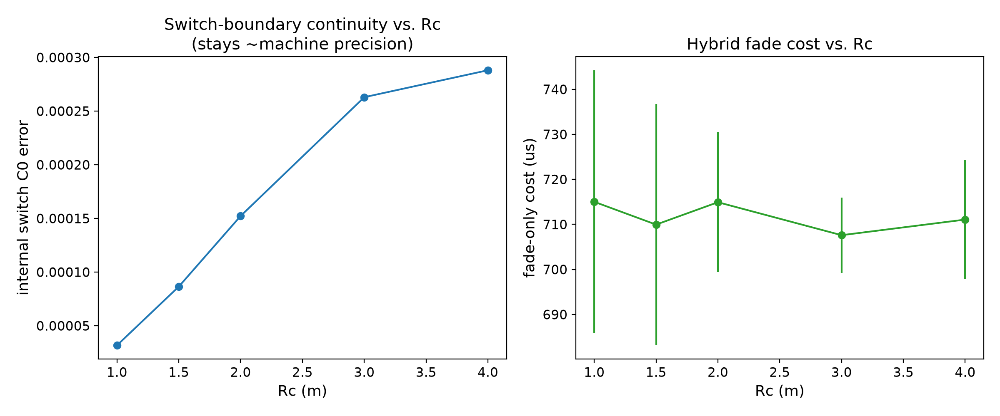

# LunarRocket

**Isaac Lab'da, 4 bacaklı bir hopper roketin gerçek kraterli/eğimli Ay arazisine rastgele hedefe indirilmesini SAC ile öğrenen görev.**

Eğitim yolu `LunarRocket-Lander-Direct-v0` (`source/lunar_rocket_lab`); sabit ana motor (gaz) + tüm yönelim kontrolü için 8'li RCS iticisi halkası (eski TVC/gimbal tasarımının yerini aldı), rastgele hedef, gerçek Ay arazisi.


*Isaac Lab içinde hopper roket ve Ay arazisi (terrain-transition deneyi).*

## Özet

| | |
|---|---|
| **Problem** | Eğimli/kraterli Ay arazisine hassas, güvenli iniş ve arazi geçiş (terrain blend) kalitesi |
| **Yöntem** | SAC (Soft Actor-Critic); iki katmanlı arazi karışımı (terrain blend) ve ablasyon çalışmaları |
| **Simülasyon / donanım** | NVIDIA Isaac Lab (direct workflow), Docker, GPU |
| **Makale** | `experiments/terrain_transition/paper/` (kaynak ve `out/full_paper_en.pdf`) |

### Sistem mimarisi



### Akış şeması (nasıl çalışır)



Arazi havuzu eğitimden bağımsız üretilir; her reset hazır bir slotu alır, politika gaz ve RCS komutlarını üretir, başarı oranı arttıkça mesafe/yanal hız zorluğu yükselir.

## Seçilmiş sonuçlar

### Sonuç 1: Arazi karışımı yarıçap taraması
Karışım yarıçapının iniş başarısına etkisi (`results/ablations/radius_sweep.csv` ham veri).



### Sonuç 2: Karışım çözünürlüğü ve geçiş genişliği
<p>


</p>

### Sonuç 3: Rc taraması


*Tüm şekiller `experiments/terrain_transition/results/` altında; istatistik testleri `significance_tests.md`.*

## Kurulum

### Gereksinimler
- Linux, NVIDIA GPU + sürücü, Docker, Isaac Lab (ayrıntı: [docs/README_ayrintili.md](docs/README_ayrintili.md))

### Adımlar
```bash
git clone https://github.com/GulogluHaktan/LunarRocket.git
cd LunarRocket
# kurulum betiği ve adımlar docs/README_ayrintili.md bölüm 2'de
```

## Kullanım

```bash
./scripts/train_isaaclab_native.sh        # eğitim
./scripts/watch_isaaclab_native.sh        # izleme
```
Hızlı duman testi: `ISAACLAB_MAX_ITERATIONS=1 ISAACLAB_NUM_ENVS=16 ./scripts/train_isaaclab_native.sh`

## Sonuçları yeniden üret

| Şekil | Komut |
|---|---|
| `results/ablations/*.png` | `python experiments/terrain_transition/run_experiment.py` ve `analyze_training_comparison.py` (parametreler için kaynak koda bak) |

## Proje yapısı

```
LunarRocket/
├── source/lunar_rocket_lab/   # Isaac Lab görev paketi
├── experiments/terrain_transition/  # deney, sonuçlar, makale
├── scripts/                   # eğitim/izleme betikleri
├── configs/  docker/  app/    # ayarlar, imaj, uygulama
├── assets/                    # sahne ve doku varlıkları
├── docs/                      # ayrıntılı README ve notlar
└── tests/
```

## Atıf, lisans, iletişim

```bibtex
@misc{lunarrocket2026,
  title  = {LunarRocket},
  author = {Haktan G{\"u}lo{\u{g}}lu},
  year   = {2026},
  url    = {https://github.com/GulogluHaktan/LunarRocket}
}
```
Lisans: TODO. İletişim: Haktan Güloğlu.
