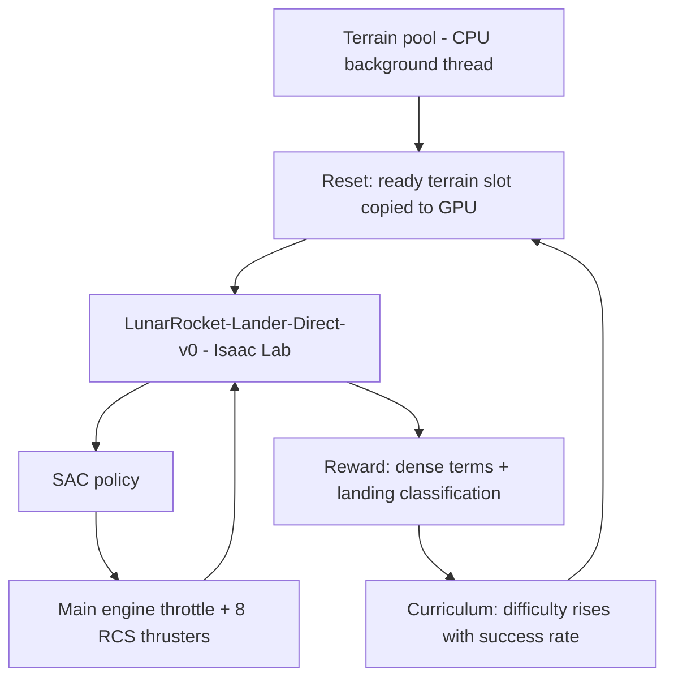

🇬🇧 English · 🇹🇷 [Türkçe](README.tr.md)

# LunarRocket

**An Isaac Lab task in which a SAC policy learns to land a 4-legged hopper rocket on real cratered/sloped lunar terrain at a randomized target.**

The training path is `LunarRocket-Lander-Direct-v0` (`source/lunar_rocket_lab`); a fixed main engine (throttle) plus a ring of 8 RCS thrusters for all attitude control (replacing the earlier TVC/gimbal design), randomized target, real lunar terrain.


*Hopper rocket and lunar terrain inside Isaac Lab (terrain-transition experiment).*

## Summary

| | |
|---|---|
| **Problem** | Precise, safe landing on sloped/cratered lunar terrain and terrain-blend quality |
| **Method** | SAC (Soft Actor-Critic); two-tier terrain blending and ablation studies |
| **Simulation / hardware** | NVIDIA Isaac Lab (direct workflow), Docker, GPU |
| **Paper** | [`experiments/terrain_transition/paper/paper_sn/main_sn.pdf`](experiments/terrain_transition/paper/paper_sn/main_sn.pdf) (manuscript; LaTeX source in the same folder) |

### System architecture


### Flow diagram (how it works)



The terrain pool is generated independently of training; every reset takes a ready slot, the policy outputs throttle and RCS commands, and as the success rate grows the distance/lateral-speed difficulty increases.

## Selected results

### Result 1: terrain-blend radius sweep
Effect of the blend radius on landing success (raw data: `results/ablations/radius_sweep.csv`).


### Result 2: blend resolution and transition width
<p>


</p>

### Result 3: Rc sweep


*All figures are under `experiments/terrain_transition/results/`; statistical tests in `significance_tests.md`.*

## Installation

### Requirements
- Linux, NVIDIA GPU + driver, Docker, Isaac Lab (details: [docs/README_ayrintili.md](docs/README_ayrintili.md))

### Steps
```bash
git clone https://github.com/GulogluHaktan/LunarRocket.git
cd LunarRocket
# installer script and steps are in docs/README_ayrintili.md, section 2
```

## Usage

```bash
./scripts/train_isaaclab_native.sh        # training
./scripts/watch_isaaclab_native.sh        # watch
```
Quick smoke test: `ISAACLAB_MAX_ITERATIONS=1 ISAACLAB_NUM_ENVS=16 ./scripts/train_isaaclab_native.sh`

## Reproducing the results

| Figure | Command |
|---|---|
| `results/ablations/*.png` | `python experiments/terrain_transition/run_experiment.py` and `analyze_training_comparison.py` (see source for parameters) |

## Project structure

```
LunarRocket/
├── source/lunar_rocket_lab/   # Isaac Lab task package
├── experiments/terrain_transition/  # experiment, results, paper
├── scripts/                   # training/watch scripts
├── configs/  docker/  app/    # configs, image, application
├── assets/                    # scene and texture assets
├── docs/                      # detailed README and notes
└── tests/
```

## Citation, license, contact

```bibtex
@misc{lunarrocket2026,
  title  = {LunarRocket},
  author = {Haktan G{\"u}lo{\u{g}}lu},
  year   = {2026},
  url    = {https://github.com/GulogluHaktan/LunarRocket}
}
```
License: TODO. Contact: Haktan Güloğlu.
